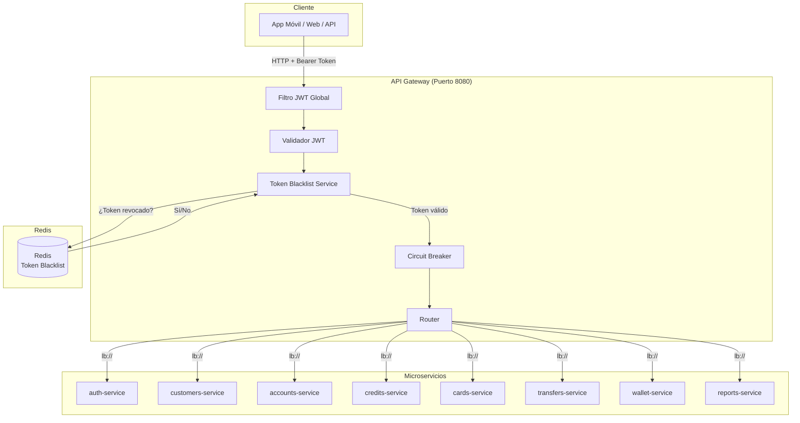
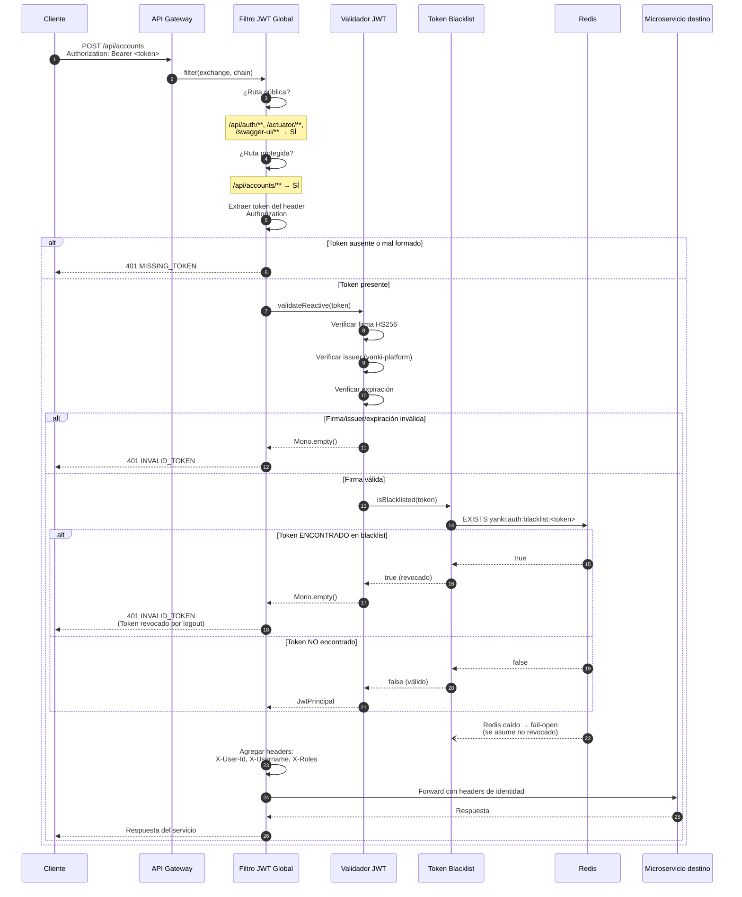
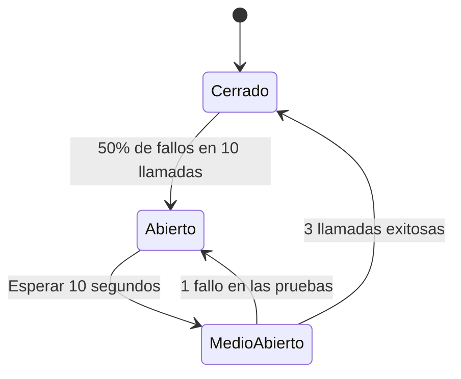

# api-gateway

## 🚪 ¿Qué es?

El **api-gateway** es la **puerta de entrada única** de toda la plataforma Yanki. Imagínalo como el recepcionista de un edificio: todo el mundo pasa por él, verifica quién eres, y te dirige al departamento (microservicio) correcto.

Cualquier petición externa —desde la aplicación móvil, la web o una API externa— llega primero aquí. El gateway decide si te deja pasar, a dónde te envía, y qué información sobre ti le pasa al servicio destino.

- **Puerto:** `8080`
- **Base de datos:** No tiene BD propia (solo enruta)
- **Cache:** Redis (lista negra de tokens revocados)
- **Stack:** Java 17, Spring Boot 3.3.5, Spring Cloud Gateway, Resilience4j, JJWT, Redis

---

## 1. ¿Qué hace?

| Responsabilidad | Qué significa en la práctica |
|---|---|
| **Enrutamiento** | Recibe `/api/customers/123` y lo envía a `customers-service` |
| **Autenticación JWT** | Verifica que el token Bearer sea válido antes de dejar pasar la petición |
| **Token Blacklist** | Consulta Redis para rechazar tokens que fueron revocados por un logout |
| **Circuit Breaker** | Si un servicio cae, devuelve un error amigable en vez de colgar |
| **CORS** | Permite que la app web (frontend) haga peticiones al gateway |
| **Headers de identidad** | Extrae `X-User-Id`, `X-Username` y `X-Roles` del JWT y los propaga |
| **Fallback unificado** | Respuesta `ApiError` estandarizada cuando un servicio no responde |

---

## 2. Arquitectura de Alto Nivel



---

## 3. Flujo de Autenticación Completo

### 3.1 ¿Qué pasa cuando un usuario hace una petición?



### 3.2 ¿Qué es la Token Blacklist y por qué existe?

Los tokens JWT son **stateless**: una vez emitidos, son criptográficamente válidos hasta su expiración natural (1 hora). Esto significa que si un usuario hace logout, su token sigue funcionando.

**La solución:** Cuando un usuario hace logout, el `auth-service` guarda el token en Redis con el tiempo restante de expiración como TTL. Cada vez que el gateway valida un token, consulta Redis para verificar si ese token fue revocado.

| Clave en Redis | Valor | TTL |
|---|---|---|
| `yanki:auth:blacklist:<token_completo>` | `1` | Tiempo restante de expiración del token |

**Patrón fail-open:** Si Redis cae, el gateway **no bloquea** el acceso. Es preferible permitir un token revocado que bloquear a todos los usuarios válidos.

---

## 4. Tabla de Rutas (Enrutamiento)

| Path | Microservicio destino | ¿Requiere JWT? |
|---|---|---|
| `/api/auth/**` | `auth-service` | ❌ No (ruta pública) |
| `/auth/**` | `auth-service` | ❌ No (ruta pública) |
| `/api/customers/**` | `customers-service` | ✅ Sí |
| `/api/accounts/**` | `accounts-service` | ✅ Sí |
| `/api/credits/**` | `credits-service` | ✅ Sí |
| `/api/cards/**` | `cards-service` | ✅ Sí |
| `/api/transfers/**` | `transfers-service` | ✅ Sí |
| `/api/wallets/**` | `wallet-service` | ✅ Sí |
| `/api/reports/**` | `reports-service` | ✅ Sí |
| `/actuator/**` | Gateway (health, metrics) | ❌ No |
| `/swagger-ui.html` | Swagger UI agregado | ❌ No |
| `/v3/api-docs/**` | OpenAPI spec agregado | ❌ No |

---

## 5. Circuit Breaker (Resilience4j)

Cuando un microservicio cae o tarda demasiado, el circuit breaker protege al gateway de colapsar.

| Parámetro | Valor | Qué significa |
|---|---|---|
| **Timeout** | 10 segundos | Si un servicio no responde en 10s, se corta |
| **Sliding Window** | 10 llamadas | Ventana de evaluación |
| **Failure Rate** | 50% | Si 5 de 10 llamadas fallan, se abre el circuito |
| **Wait Duration** | 10 segundos | Tiempo antes de intentar de nuevo |
| **Half-Open Calls** | 3 | Intentos de prueba antes de cerrar el circuito |



---

## 6. Headers Propagados

Cuando un token es válido, el gateway extrae la información del JWT y la agrega como headers HTTP para que el microservicio destino sepa quién es el usuario:

| Header | Origen | Ejemplo |
|---|---|---|
| `X-User-Id` | Claim `userId` del JWT | `CUST-001` |
| `X-Username` | Claim `sub` del JWT | `operador@yanki.com` |
| `X-Roles` | Claim `roles` del JWT | `ROLE_OPERATOR,ROLE_ADMIN` |

**Nota de seguridad:** Los headers entrantes con estos nombres se **eliminan** antes de propagar, para evitar que un cliente malicioso los suplante.

---

## 7. Configuración

### 7.1 Variables de Entorno

| Variable | Default | Descripción |
|---|---|---|
| `SERVER_PORT` | `8080` | Puerto HTTP |
| `EUREKA_URL` | `http://discovery-service:8761/eureka/` | Service Discovery |
| `CONFIG_SERVER_URL` | `http://localhost:8888` | Config Server |
| `JWT_SECRET` | **REQUERIDO** | Clave HS256 (mínimo 32 caracteres) — **debe coincidir con auth-service** |
| `JWT_ISSUER` | `yanki-platform` | Emisor del token — **debe coincidir con auth-service** |
| `JWT_EXPIRATION` | `1h` | Expiración máxima del token |
| `JWT_MAX_LIFETIME_GRACE` | `5m` | Tolerancia de desfase de reloj |
| `REDIS_HOST` | `localhost` | Host Redis (token blacklist) |
| `REDIS_PORT` | `6379` | Puerto Redis |

### 7.2 Rutas Públicas

Las siguientes rutas **no requieren** autenticación JWT:

```yaml
yanki:
  security:
    public-paths:
      - /api/auth/**
      - /auth/**
      - /actuator/**
      - /v3/api-docs/**
      - /swagger-ui/**
      - /swagger-ui.html
      - /fallback/**
```

---

## 8. Cómo Ejecutarlo

### 8.1 Desarrollo Local

```powershell
$env:JAVA_HOME="C:\Program Files\Java\jdk-17.0.21.0.3"
$env:PATH="$env:JAVA_HOME\bin;$env:PATH"
mvn spring-boot:run
```

### 8.2 Build y Pruebas

```powershell
mvn clean verify
```

### 8.3 Docker

```bash
docker build -t yanki/api-gateway:1.0.0 .
docker run -p 8080:8080 \
  -e EUREKA_URL=http://host.docker.internal:8761/eureka/ \
  -e CONFIG_SERVER_URL=http://host.docker.internal:8888 \
  -e JWT_SECRET=<32-chars-min> \
  -e JWT_ISSUER=yanki-platform \
  -e REDIS_HOST=host.docker.internal \
  yanki/api-gateway:1.0.0
```

### 8.4 Verificar Salud

```bash
curl http://localhost:8080/actuator/health
```

---

## 9. Estructura del Código

```
src/main/java/com/yanki/gateway
├── ApiGatewayApplication.java
├── domain
│   └── model
│       └── JwtPrincipal.java              # Identidad extraída del JWT
├── infrastructure
│   ├── cache
│   │   └── TokenBlacklistService.java     # Consulta Redis para tokens revocados
│   ├── config
│   │   ├── GatewayCorsConfiguration.java  # Configuración CORS
│   │   ├── GatewayCorsProperties.java     # Propiedades CORS
│   │   ├── GatewayPublicPathProperties.java # Rutas públicas
│   │   ├── GatewaySecurityProperties.java # Propiedades JWT
│   │   └── JwtTokenValidator.java         # Valida firma + blacklist
│   ├── filter
│   │   ├── GatewayErrorHandler.java       # Manejo de errores de gateway
│   │   └── JwtAuthenticationGlobalFilter.java # Filtro global de autenticación
│   └── support
│       └── ErrorResponseWriter.java       # Escribe respuestas 401
└── interfaces
    └── rest
        ├── FallbackController.java        # Endpoints de fallback
        └── dto
            └── ApiError.java              # DTO de error unificado
```

---

## 10. Casos de Uso

### CU-01: Petición autenticada exitosa

1. Cliente envía petición con `Authorization: Bearer <token>`
2. Gateway verifica firma HS256, issuer y expiración
3. Gateway consulta Redis: token **no** está en blacklist
4. Gateway agrega headers `X-User-Id`, `X-Username`, `X-Roles`
5. Gateway enruta al microservicio destino
6. Microservicio responde → Gateway reenvía la respuesta al cliente

### CU-02: Petición sin token

1. Cliente envía petición sin header `Authorization`
2. Gateway responde `401 MISSING_TOKEN`
3. La petición **no** llega al microservicio destino

### CU-03: Token inválido o expirado

1. Cliente envía petición con token mal firmado o expirado
2. Gateway responde `401 INVALID_TOKEN`
3. La petición **no** llega al microservicio destino

### CU-04: Token revocado por logout

1. Cliente hizo logout previamente (token en blacklist de Redis)
2. Cliente envía petición con el mismo token
3. Gateway valida firma correctamente
4. Gateway consulta Redis: token **sí** está en blacklist
5. Gateway responde `401 INVALID_TOKEN` (token revocado)

### CU-05: Servicio destino caído

1. Cliente envía petición válida
2. Gateway intenta contactar al microservicio destino
3. Servicio no responde en 10 segundos (timeout)
4. Circuit breaker registra el fallo
5. Gateway responde con fallback: `503 Service Unavailable`

---

## 11. Referencias

- `Proyecto General vf.md` — Parte II § API Gateway, JWT, Circuit Breaker
- `README.md` (raíz) — Arquitectura general de la plataforma
- `AGENTS.md` (raíz) — Reglas de oro de trazabilidad y arquitectura hexagonal
- `auth-service/README.md` — Servicio de autenticación y emisión de tokens
- `config-repo/application.yml` — Configuración centralizada
- `CASOS_USO/` — Casos de uso relacionados con autenticación y autorización
- `system-prompt-auditoria-hexagonal-yanki.md` — Guía de auditoría hexagonal
