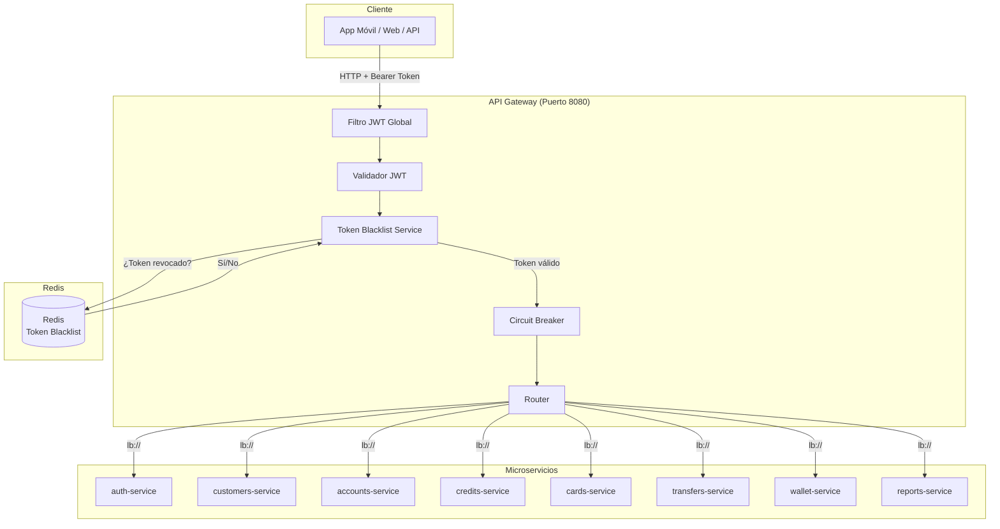
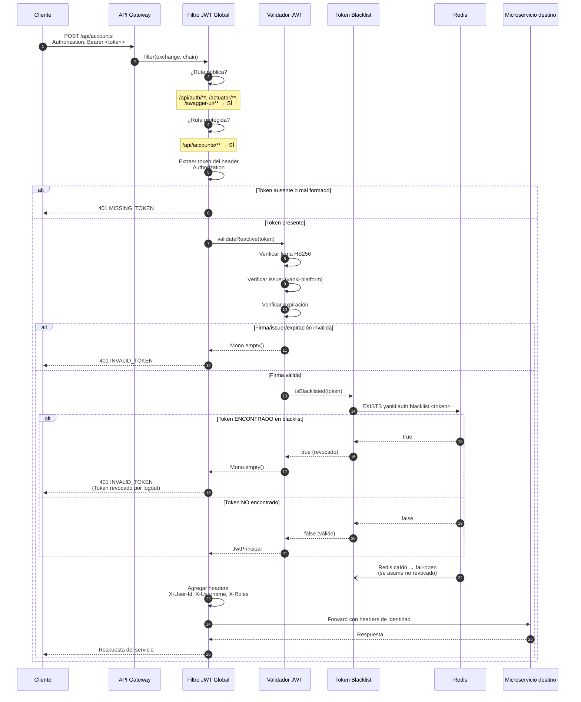
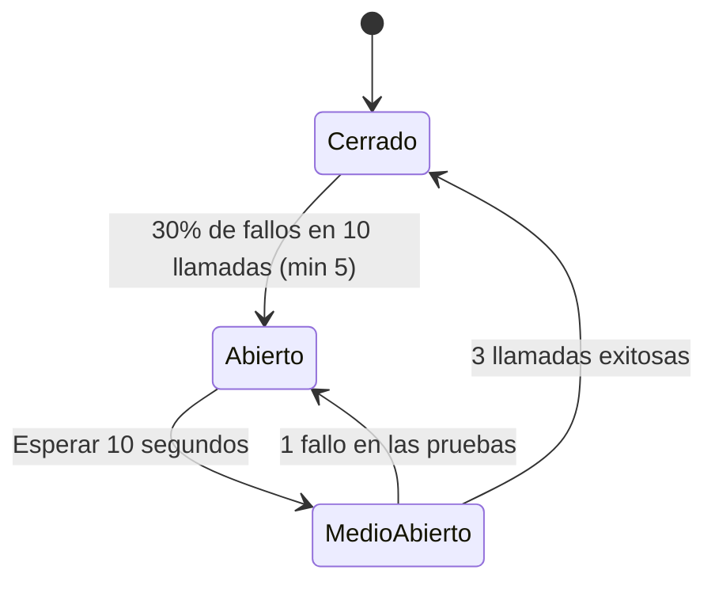

# api-gateway

## 🚪 ¿Qué es?

El **api-gateway** es la **puerta de entrada única** de toda la plataforma Yanki. Imagínalo como el recepcionista de un edificio: todo el mundo pasa por él, verifica quién eres, y te dirige al departamento (microservicio) correcto.

Cualquier petición externa —desde la aplicación móvil, la web o una API externa— llega primero aquí. El gateway decide si te deja pasar, a dónde te envía, y qué información sobre ti le pasa al servicio destino.

- **Puerto:** `8080`
- **Base de datos:** No tiene BD propia (solo enruta)
- **Cache:** Redis (lista negra de tokens revocados)
- **Stack:** Java 17, Spring Boot 3.3.5, Spring Cloud Gateway, Resilience4j, JJWT, Redis Reactive

---

## 1. ¿Qué hace?

| Responsabilidad | Qué significa en la práctica |
|---|---|
| **Enrutamiento** | Recibe `/api/customers/123` y lo envía a `customers-service` vía `lb://` (Eureka) |
| **Autenticación JWT** | Valida firma HS256, issuer, expiración y vida máxima del token |
| **Token Blacklist** | Consulta Redis para rechazar tokens revocados por logout (patrón fail-open) |
| **Circuit Breaker** | Resilience4j: si un servicio cae, responde 503 con `ApiError` estandarizado |
| **CORS** | Configuración centralizada y externalizada (`yanki.gateway.cors.*`) |
| **Headers de identidad** | Propaga `X-User-Id`, `X-Username`, `X-Customer-Id` y `X-Roles` al downstream |
| **Error Handling** | `GatewayErrorHandler` unificado: traduce excepciones a `ApiError` JSON |
| **Fallback** | `FallbackController` responde 503 cuando el circuit breaker abre |

---

## 2. Arquitectura de Alto Nivel



---

## 3. Flujo de Autenticación Completo

### 3.1 ¿Qué pasa cuando un usuario hace una petición?



### 3.2 ¿Qué es la Token Blacklist y por qué existe?

Los tokens JWT son **stateless**: una vez emitidos, son criptográficamente válidos hasta su expiración natural (1 hora). Esto significa que si un usuario hace logout, su token sigue funcionando.

**La solución:** Cuando un usuario hace logout, el `auth-service` guarda el token en Redis con el tiempo restante de expiración como TTL. Cada vez que el gateway valida un token, consulta Redis para verificar si ese token fue revocado.

| Clave en Redis | Valor | TTL |
|---|---|---|
| `yanki:auth:blacklist:<token_completo>` | `1` | Tiempo restante de expiración del token |

**Patrón fail-open:** Si Redis cae, el gateway **no bloquea** el acceso. Es preferible permitir un token revocado que bloquear a todos los usuarios válidos.

---

## 4. Tabla de Rutas (Enrutamiento)

| Path | Microservicio destino | ¿Requiere JWT? |
|---|---|---|
| `/api/auth/**` | `auth-service` | ❌ No (ruta pública) |
| `/auth/**` | `auth-service` | ❌ No (ruta pública) |
| `/api/customers/**` | `customers-service` | ✅ Sí |
| `/api/accounts/**` | `accounts-service` | ✅ Sí |
| `/api/credits/**` | `credits-service` | ✅ Sí |
| `/api/cards/**` | `cards-service` | ✅ Sí |
| `/api/transfers/**` | `transfers-service` | ✅ Sí |
| `/api/wallets/**` | `wallet-service` | ✅ Sí |
| `/api/reports/**` | `reports-service` | ✅ Sí |
| `/actuator/**` | Gateway (health, metrics) | ❌ No |
| `/swagger-ui.html` | Swagger UI agregado | ❌ No |
| `/v3/api-docs/**` | OpenAPI spec agregado | ❌ No |

---

## 5. Circuit Breaker (Resilience4j)

Cuando un microservicio cae o tarda demasiado, el circuit breaker protege al gateway de colapsar.

| Parámetro | Valor | Qué significa |
|---|---|---|
| **Timeout** | 10 segundos | TimeLimiter: si un servicio no responde en 10s, se corta |
| **Sliding Window** | 10 llamadas (COUNT_BASED) | Ventana de evaluación |
| **Minimum Calls** | 5 | Llamadas mínimas antes de evaluar el circuito |
| **Failure Rate** | 30% | Si 3 de 10 llamadas fallan, se abre el circuito |
| **Wait Duration** | 10 segundos | Tiempo en estado abierto antes de probar de nuevo |
| **Half-Open Calls** | 3 | Intentos de prueba antes de cerrar el circuito |



### Configuración en `application.yml`

```yaml
resilience4j:
  timelimiter:
    configs:
      default:
        timeoutDuration: 10s
        cancelRunningFuture: true
  circuitbreaker:
    configs:
      default:
        slidingWindowType: COUNT_BASED
        slidingWindowSize: 10
        minimumNumberOfCalls: 5
        failureRateThreshold: 30
        waitDurationInOpenState: 10s
        permittedNumberOfCallsInHalfOpenState: 3
        automaticTransitionFromOpenToHalfOpenEnabled: true
```

Cada ruta del gateway aplica el filtro `CircuitBreaker` con `name: default` y `fallbackUri: forward:/fallback/circuit-breaker`.

---

## 6. Headers Propagados

Cuando un token es válido, el gateway extrae la información del JWT y la agrega como headers HTTP para que el microservicio destino sepa quién es el usuario:

| Header | Origen | Ejemplo |
|---|---|---|
| `X-User-Id` | Claim `sub` (o `userId`) del JWT | `CUST-001` |
| `X-Username` | Claim `username` (o `preferred_username`) del JWT | `operador@yanki.com` |
| `X-Customer-Id` | Claim `customerId` del JWT | `CUSTID01` |
| `X-Roles` | Claim `roles` (o `authorities`/`scope`) del JWT | `ROLE_OPERATOR,ROLE_ADMIN` |

**Nota de seguridad:** Los headers entrantes con estos nombres se **eliminan** antes de propagar, para evitar que un cliente malicioso los suplante.

### Resolución de claims

El validador resuelve los claims con la siguiente prioridad:

- **userId**: `sub` → `userId` → `""`
- **username**: `username` → `preferred_username` → `userId`
- **customerId**: `customerId` → `""`
- **roles**: `roles` → `authorities` → `scope` (separador: `,` para roles/authorities, ` ` para scope)

---

## 7. Configuración

### 7.1 Variables de Entorno

| Variable | Default | Descripción |
|---|---|---|
| `SERVER_PORT` | `8080` | Puerto HTTP |
| `EUREKA_URL` | `http://discovery-service:8761/eureka/` | Service Discovery (Eureka) |
| `CONFIG_SERVER_URL` | `http://localhost:8888` | Config Server (Spring Cloud Config) |
| `JWT_SECRET` | **REQUERIDO** | Clave HS256 (mínimo 32 bytes) — **debe coincidir con auth-service** |
| `JWT_ISSUER` | `yanki-platform` | Emisor del token — **debe coincidir con auth-service** |
| `JWT_EXPIRATION` | `1h` | Expiración máxima del token |
| `JWT_MAX_LIFETIME_GRACE` | `5m` | Tolerancia de desfase de reloj |
| `REDIS_HOST` | `localhost` | Host Redis (token blacklist) |
| `REDIS_PORT` | `6379` | Puerto Redis |
| `CORS_ALLOWED_ORIGINS` | (vacío) | Orígenes CORS permitidos |
| `CORS_ALLOWED_METHODS` | `GET,POST,PUT,PATCH,DELETE,OPTIONS` | Métodos CORS permitidos |
| `CORS_ALLOWED_HEADERS` | `Authorization,Content-Type,Accept,X-Request-ID,X-Correlation-ID` | Headers CORS permitidos |
| `CORS_ALLOW_CREDENTIALS` | `false` | Permitir credenciales cross-origin |
| `CORS_MAX_AGE` | `1h` | Cache de preflight CORS |

### 7.2 Propiedades del Gateway

Las propiedades se externalizan con el prefijo `yanki.security`:

```yaml
yanki:
  security:
    jwt:
      secret: ${JWT_SECRET:}
      issuer: ${JWT_ISSUER:yanki-platform}
      expiration: ${JWT_EXPIRATION:1h}
      max-lifetime-grace: ${JWT_MAX_LIFETIME_GRACE:5m}
    public-paths:
      - /api/auth/**
      - /auth/**
      - /actuator/**
      - /v3/api-docs/**
      - /swagger-ui/**
      - /swagger-ui.html
      - /fallback/**
  gateway:
    cors:
      allowed-origins: ${CORS_ALLOWED_ORIGINS:}
      allowed-methods: ${CORS_ALLOWED_METHODS:GET,POST,PUT,PATCH,DELETE,OPTIONS}
      allowed-headers: ${CORS_ALLOWED_HEADERS:Authorization,Content-Type,Accept,X-Request-ID,X-Correlation-ID}
      exposed-headers: ${CORS_EXPOSED_HEADERS:}
      allow-credentials: ${CORS_ALLOW_CREDENTIALS:false}
      max-age: ${CORS_MAX_AGE:1h}
```

### 7.3 Rutas Públicas

Las siguientes rutas **no requieren** autenticación JWT:

| Ruta | Descripción |
|---|---|
| `/api/auth/**` | Endpoints de autenticación (login, refresh) |
| `/auth/**` | Endpoints de autenticación directos |
| `/actuator/**` | Health, metrics, info, gateway routes |
| `/v3/api-docs/**` | OpenAPI spec agregado |
| `/swagger-ui/**` | Swagger UI |
| `/swagger-ui.html` | Swagger UI entry point |
| `/fallback/**` | Endpoints de fallback del circuit breaker |

---

## 8. Cómo Ejecutarlo

### 8.1 Desarrollo Local

```powershell
$env:JAVA_HOME="C:\Program Files\Java\jdk-17.0.21.0.3"
$env:PATH="$env:JAVA_HOME\bin;$env:PATH"
mvn spring-boot:run
```

### 8.2 Build y Pruebas

```powershell
mvn clean verify
```

### 8.3 Docker

```bash
docker build -t yanki/api-gateway:1.0.0 .
docker run -p 8080:8080 \
  -e EUREKA_URL=http://host.docker.internal:8761/eureka/ \
  -e CONFIG_SERVER_URL=http://host.docker.internal:8888 \
  -e JWT_SECRET=<32-chars-min> \
  -e JWT_ISSUER=yanki-platform \
  -e REDIS_HOST=host.docker.internal \
  yanki/api-gateway:1.0.0
```

### 8.4 Verificar Salud

```bash
curl http://localhost:8080/actuator/health
```

---

## 9. Estructura del Código

```
src/main/java/com/yanki/gateway
├── ApiGatewayApplication.java
├── domain
│   └── model
│       └── JwtPrincipal.java              # Record: identidad extraída del JWT
├── infrastructure
│   ├── cache
│   │   └── TokenBlacklistService.java     # Consulta Redis (fail-open) para tokens revocados
│   ├── config
│   │   ├── GatewayCorsConfiguration.java  # CorsWebFilter reactivo
│   │   ├── GatewayCorsProperties.java     # Propiedades CORS (yanki.gateway.cors.*)
│   │   ├── GatewayPublicPathProperties.java # Rutas públicas (yanki.security.public-paths)
│   │   ├── GatewaySecurityProperties.java # Propiedades JWT (yanki.security.jwt.*)
│   │   └── JwtTokenValidator.java         # Valida firma HS256, issuer, exp, blacklist
│   ├── filter
│   │   ├── GatewayErrorHandler.java       # ErrorWebExceptionHandler unificado (@Order -2)
│   │   └── JwtAuthenticationGlobalFilter.java # GlobalFilter: auth JWT + propagación headers
│   └── support
│       └── ErrorResponseWriter.java       # Serializa ApiError a JSON (compartido)
└── interfaces
    └── rest
        ├── FallbackController.java        # /fallback/** → 503 SERVICE_UNAVAILABLE
        └── dto
            └── ApiError.java              # Record: error unificado (timestamp, status, error, code, message, path, details)
```

## 10. Manejo de Errores Unificado

La gateway centraliza el manejo de errores en dos componentes:

| Componente | Rol |
|---|---|
| `GatewayErrorHandler` | `ErrorWebExceptionHandler` (@Order -2): intercepta excepciones que escapan de la cadena de filtros y las traduce a `ApiError` JSON |
| `ErrorResponseWriter` | Serializa `ApiError` a JSON y escribe la respuesta HTTP (compartido por filter y errorHandler) |
| `FallbackController` | Endpoint `/fallback/**`: responde 503 cuando el circuit breaker abre |

### Códigos de Error

| Escenario | Status | Code | Componente |
|---|---|---|---|
| Token ausente o mal formado | 401 | `MISSING_TOKEN` | `JwtAuthenticationGlobalFilter` |
| Token inválido, expirado o revocado | 401 | `INVALID_TOKEN` | `JwtAuthenticationGlobalFilter` |
| Servicio no disponible (Eureka, conexión) | 503 | `SERVICE_UNAVAILABLE` | `GatewayErrorHandler` / `FallbackController` |
| Timeout del destino (10s) | 504 | `GATEWAY_TIMEOUT` | `GatewayErrorHandler` |
| Circuit breaker abierto | 503 | `SERVICE_UNAVAILABLE` | `GatewayErrorHandler` |
| Error interno no controlado | 500 | `INTERNAL_ERROR` | `GatewayErrorHandler` |
| Método HTTP no permitido | 405 | `METHOD_NOT_ALLOWED` | `GatewayErrorHandler` |
| Recurso no encontrado | 404 | `NOT_FOUND` | `GatewayErrorHandler` |

### Formato de Error (`ApiError`)

```json
{
  "timestamp": "2026-11-22T13:00:00Z",
  "status": 401,
  "error": "Unauthorized",
  "code": "INVALID_TOKEN",
  "message": "El token JWT es invalido, ha expirado, no cumple la politica de seguridad o ha sido revocado",
  "path": "/api/accounts/123",
  "details": ["InvalidTokenException: Firma o claims invalidos: ..."]
}
```

---

## 11. Casos de Uso

### CU-01: Petición autenticada exitosa

1. Cliente envía petición con `Authorization: Bearer <token>`
2. `JwtAuthenticationGlobalFilter` verifica firma HS256, issuer, expiración y vida máxima
3. `TokenBlacklistService` consulta Redis: token **no** está en blacklist
4. Filter agrega headers `X-User-Id`, `X-Username`, `X-Customer-Id`, `X-Roles`
5. Gateway enruta al microservicio destino vía `lb://`
6. Microservicio responde → Gateway reenvía la respuesta al cliente

### CU-02: Petición sin token

1. Cliente envía petición sin header `Authorization`
2. `JwtAuthenticationGlobalFilter` responde `401 MISSING_TOKEN`
3. La petición **no** llega al microservicio destino

### CU-03: Token inválido o expirado

1. Cliente envía petición con token mal firmado o expirado
2. `JwtTokenValidator` detecta firma/issuer/expiración inválida
3. `JwtAuthenticationGlobalFilter` responde `401 INVALID_TOKEN`
4. La petición **no** llega al microservicio destino

### CU-04: Token revocado por logout

1. Cliente hizo logout previamente (auth-service guardó token en Redis)
2. Cliente envía petición con el mismo token
3. `JwtTokenValidator` valida firma correctamente
4. `TokenBlacklistService` consulta Redis: token **sí** está en blacklist (`yanki:auth:blacklist:<token>`)
5. `JwtAuthenticationGlobalFilter` responde `401 INVALID_TOKEN` (token revocado)

### CU-05: Servicio destino caído

1. Cliente envía petición válida con token correcto
2. Gateway intenta contactar al microservicio destino
3. Servicio no responde en 10 segundos (TimeLimiter timeout)
4. Resilience4j registra el fallo; si supera 30% de fallos, abre el circuit breaker
5. `FallbackController` responde `503 SERVICE_UNAVAILABLE` con `ApiError`

### CU-06: Redis caído (fail-open)

1. Cliente envía petición con token válido
2. `TokenBlacklistService` intenta consultar Redis
3. Redis no responde → se asume que el token **no** está revocado
4. La petición continúa y se enruta al microservicio destino
5. **Nota:** Es preferible permitir un token revocado que bloquear a todos los usuarios válidos

---

## 12. Referencias

- `Proyecto General vf.md` — Parte II § API Gateway, JWT, Circuit Breaker
- `README.md` (raíz) — Arquitectura general de la plataforma
- `AGENTS.md` (raíz) — Reglas de oro de trazabilidad y arquitectura hexagonal
- `auth-service/README.md` — Servicio de autenticación y emisión de tokens
- `config-repo/application.yml` — Configuración centralizada
- `../docs/CASOS_USO` — Casos de uso relacionados con autenticación y autorización
- `system-prompt-auditoria-hexagonal-yanki.md` — Guía de auditoría hexagonal
- `api/api-gateway.yaml` — Contrato OpenAPI 3.0 completo con schemas, endpoints y errores
